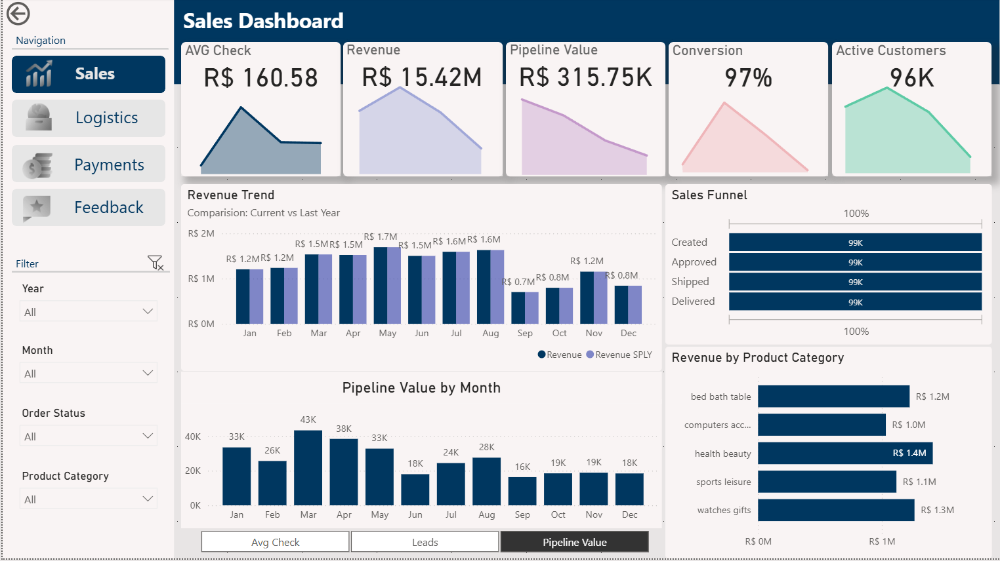
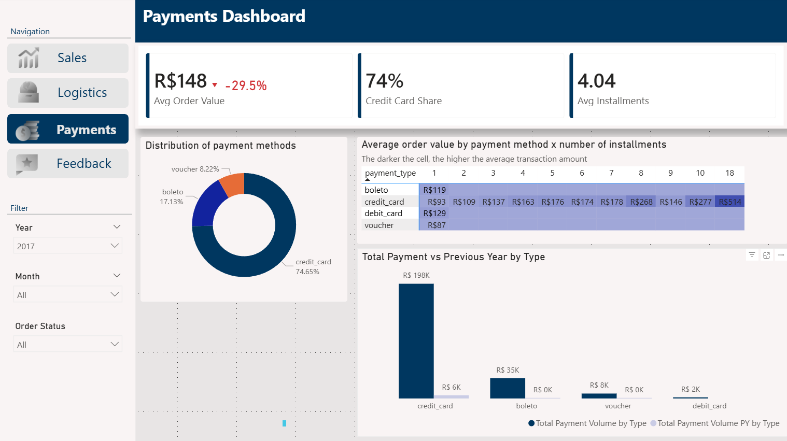
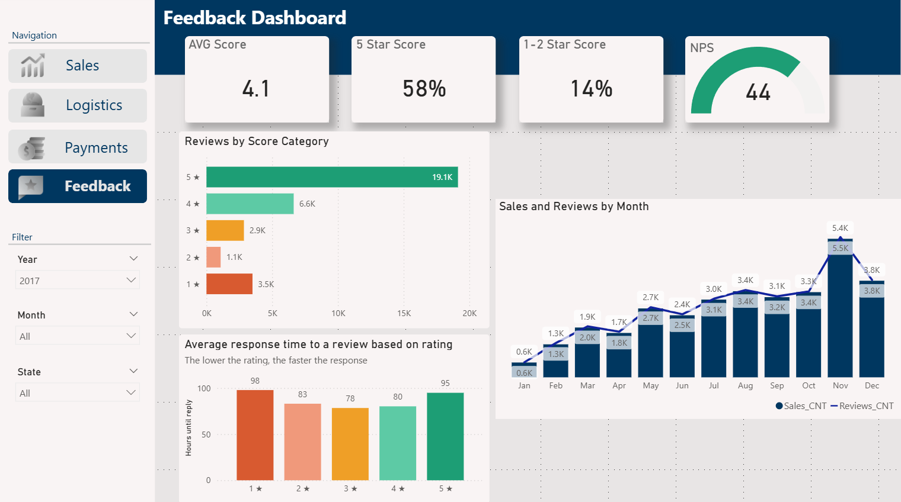

# 📊 Olist E-Commerce Dashboard (Power BI)

Multi-page Power BI report for a Brazilian e-commerce marketplace. It covers **Sales, Logistics, Payments and Feedback**, highlights problem areas and helps to form hypotheses for improvement. Based on the public **Olist Brazilian E-Commerce dataset**.

> 🖼️ The report file is not included in this repository – screenshots of the pages are shown below.

### Sales


### Payments


### Feedback


---

## 🧰 Tech Stack

| Area | What was used |
|---|---|
| **BI tool** | Power BI Desktop |
| **Data preparation** | Power Query (M): data type fixing, **merge queries** (product category translation to English), removal of unused columns and tables |
| **Data modeling** | Relational model across 8 Olist tables, one-to-many relationships, **active and inactive relationships** to a Calendar table, hierarchies, cleaned model (only needed fields) |
| **DAX – scalar** | KPI measures such as `CALCULATE`, `DIVIDE`, `DISTINCTCOUNT` |
| **DAX – iterators** | `SUMX`, `AVERAGEX` for averages and ratios |
| **DAX – time intelligence** | Year-over-year comparison (`SAMEPERIODLASTYEAR` / `DATEADD`) |
| **DAX – table functions** | Calendar table (`CALENDAR`) |
| **DAX – switching & funnel** | `SWITCH` for the metric switcher, `USERELATIONSHIP` for date-driven funnel stages |
| **Calculated column** | Custom product category grouping in the products table |
| **Visuals** | KPI cards with trend areas, clustered columns, combo chart (columns + line), bar charts, donut, funnel, matrix heatmap with conditional formatting, gauge, map |
| **Interactivity** | Slicers, cross-filtering, buttons (page navigation, metric switching, clear filters) |
| **UX/UI** | Custom theme (no default themes), consistent layout, Z-reading pattern |
| **Version control / publishing** | Git, GitHub |

## ⚙️ Functionality

- **Navigation panel** on every page for switching between Sales, Logistics, Payments and Feedback
- **Dynamic calendar** – Year / Month filters driven by a DAX Calendar table
- **At least 3 filters per page** (date + other fields: Order Status, Product Category, State)
- **Cross-filtering** between all visuals on a page
- **Metric switcher via DAX** – Avg Check / Leads / Pipeline Value on one chart (Sales)
- **Year-over-year comparison** – revenue vs same period last year; Avg Order Value vs previous year with a red/green change indicator
- **Sales funnel** – Created → Approved → Shipped → Delivered, each stage controlled by its own date
- **Top-N rating** – top product categories by revenue
- **Clear-filters button** (Sales)
- **Semantic colors** – 1★ → 5★ rating scale from red to green

## 🎯 Goal

Give business stakeholders one place to monitor sales, delivery performance, payment behavior and customer satisfaction – and to drill into the numbers with filters, a calendar and metric switchers.

## 🗂️ Data & Data Model

Eight Olist tables: `customers`, `orders`, `order_items`, `order_payments`, `order_reviews`, `products`, `sellers`, `product_category_name_translation`, plus a DAX-generated **Calendar** table.

```
customers ──(customer_id)──┐
payments ───(order_id)─────┤
reviews ────(order_id)─────┼──► orders ◄── Calendar
order_items ─(order_id)────┘      (active: purchase date;
     │                             inactive: approved / shipped / delivered dates)
     ├──(product_id)──► products ──(category name)──► category_translation
     └──(seller_id)───► sellers
```

## 📊 Report Pages

| Page | Content |
|---|---|
| 📈 **Sales** | KPIs (AVG Check, Revenue, Pipeline Value, Conversion, Active Customers) · revenue vs last year by month · switchable chart (Avg Check / Leads / Pipeline Value) · sales funnel · top-5 categories by revenue |
| 🚚 **Logistics** | Delivery performance KPIs and geographic distribution of sellers |
| 💳 **Payments** | KPIs (Avg Order Value with YoY change, Credit Card Share, Avg Installments) · payment method donut · average order value by method × installments (heatmap) · payment volume vs previous year by type |
| ⭐ **Feedback** | KPIs (AVG score, 5★ share, 1–2★ share, NPS gauge) · reviews by score · average response time by rating · monthly orders and reviews |

## 🔍 Key Insights

*Figures are taken from the report visuals (Sales: all years; Payments and Feedback: year 2017).*

**Sales**
- Revenue reaches **R$15.42M** with an average check of **R$160.58** and **96K active customers**; conversion is **97%**, and **R$315.75K** is still in the pipeline.
- Monthly revenue holds at **R$1.5–1.7M from March to August** (peak in May, R$1.7M) and drops to **R$0.7–0.8M in September–October**.
- Top categories by revenue: **health & beauty (R$1.4M)**, watches & gifts (R$1.3M), bed bath table (R$1.2M), sports & leisure (R$1.1M), computers accessories (R$1.0M).
- Pipeline value is highest in **March (R$43K)** and lowest in **September (R$16K)**.

**Payments (2017)**
- **Credit card dominates: 74.65%** of payments, followed by boleto (17.13%) and voucher (8.22%).
- Average order value grows with the number of installments: from **R$93 (1 installment)** to **R$514 (18 installments)** on credit cards.
- Average order value is **R$148, down 29.5%** vs the previous year; average number of installments is **4.04**.

**Feedback (2017)**
- Average score **4.1**; **58%** of reviews are 5★ and **14%** are 1–2★ (NPS **44**).
- Ratings are polarized: **3.5K 1★ reviews – more than 2★ (1.1K) and 3★ (2.9K)**.
- **Response time is the slowest for 1★ (98 h) and 5★ (95 h)** and the fastest for 3★ (78 h).
- Review volume follows orders almost 1:1 and peaks in **November (5.5K orders / 5.4K reviews)**.

**Business takeaways**
- Plan promotions and stock for the weak September–October period.
- Reduce the response time to 1–2★ reviews first.
- Installments drive higher-value purchases – promote them for expensive categories.
- Investigate the 29.5% drop in average order value (mix of payment methods / categories).

## 👤 Author

**Viktoriia Hetman**
[GitHub](https://github.com/hetman07) · [LinkedIn](https://www.linkedin.com/in/viktoriia-hetman-1376631b6)
